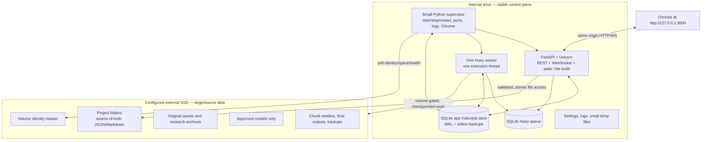

# DocuForge — First-Task Assessment and Milestone 1 Plan

**Date:** 2026-11-22
**Branch inspected:** `arena/3e79c7b2-docuforge` at `2e0f851e37c3da5ccdd8f1ec1c397f2385ea73a1`
**Status update (2026-11-22):** approved by the user; implementation proceeded on the listed M1 scope. Pre-approval language below is retained as the planning record.

Companion deliverables:

- [Repository Evaluation Report](repository-evaluation-report.md)
- [Seeded Dependency and Attribution Register](dependency-attribution-register.csv)

## 1. Workspace and history inspection

### Current repository

The checkout is clean and extremely small: 15 tracked files, about 153 KB including Git metadata. It contains:

- `README.md`
- `projects/.gitkeep`
- one plain-file project, `projects/first-documentary/`, with a project manifest, script, source/fact-check registries, asset/music/font registries, shot list and publishing notes

There is **no current application code**, package manifest, lockfile, test suite, Python environment, frontend, backend or launcher.

The existing project files are user work and will not be overwritten, moved or silently migrated. A future M1 scanner should index the legacy project read-only, report schema differences, and require approval before any migration.

### Git history finding

The current base is PR #10, “Remove application code.” Its merged change intentionally deleted 40 application/build/test files and retained the README and project files. GitHub history shows earlier Node/Fastify/React work, but that implementation is no longer in the current tree. The current specification also explicitly requires Python/FastAPI/SQLAlchemy, so restoring the deleted Node backend would conflict with the requested architecture.

The README is stale relative to both the tree and the new requirements. In particular, it describes missing files and a deleted Fastify backend, and documents a default `HOST=0.0.0.0`, which conflicts with the required secure default `127.0.0.1`. It should be replaced only during approved M1 work, with the old content preserved in Git history.

## 2. Hardware compatibility report

### Important measurement boundary

The development checkout is running in a Linux sandbox, **not on the user's Windows 11 computer**. Therefore the sandbox readings below are useful for engineering diagnostics only and are not represented as the user's hardware.

A deleted historical acceptance document claimed a Windows test on an Intel Core i3-7020U, about 8 GB RAM, Node 24.15.0 and FFmpeg 8.1. Because the current request says the exact CPU generation is unknown, that historical claim is treated as **unconfirmed**. The approved M1 first-launch scan must be authoritative.

### Measured in the current sandbox

| Item | Measured result |
|---|---|
| OS | Debian 12, Linux 6.1, x86-64, KVM virtual machine |
| CPU | 1 virtual core / 2 threads, Intel Xeon reported at 2.60 GHz |
| RAM | 3.8 GiB total, about 3.6 GiB available at inspection |
| Swap | None |
| GPU/VRAM | No display device exposed |
| Disk | One 21.8 GB virtual disk, about 19.3 GB available; no external volume |
| Python | 3.11.2 |
| Node/npm | Node 22.22.3; npm 10.9.8 |
| FFmpeg/ffprobe | Not installed |
| Ollama/llama.cpp | Not installed |
| M1 Python packages | Not installed |
| Global npm packages | npm and Corepack only |

No package or runtime was installed during this assessment.

### Declared target and compatibility

| Target capability | Assessment on Windows 11 / Core i3 / 8 GB / Intel iGPU | Policy |
|---|---|---|
| M1 local web app, SQLite, project files | **Suitable** | One API process and one lightweight worker; static frontend served by FastAPI in normal use. |
| Chrome editor | **Suitable with discipline** | Avoid many open projects/tabs and large in-memory asset lists. Virtualise future timelines. |
| Hardware/resource monitoring | **Suitable** | psutil plus fixed PowerShell CIM commands; no resident vendor GPU SDK. |
| Research/browser extraction | **Conditional but feasible** | Sequential tasks; at most one Playwright browser context. |
| Local LLM | **Highly constrained** | One verified small 1–3B quantised model at a time. A 7B model is not a safe default on 8 GB. Never auto-download. |
| Local TTS/STT | **Likely feasible, unverified** | CPU bake-offs are mandatory; tiny/base/int8 models only until measured. |
| 1080p FFmpeg render | **Feasible but potentially slow** | Proxy/chunked workflow; validate Quick Sync before use, otherwise low-memory `libx264`. |
| 4K or 60 fps | **Not a default** | Optional only after measured proof; no speed promise. |
| CPU still-image generation | **Possible but slow** | M6 bake-off only; no historical “real photo” claim for generated imagery. |
| Generative video models | **Not feasible** | Do not install on this machine. |
| Multiple AI models concurrently | **Unsafe** | Worker concurrency one and a global memory lease. |

### First-launch detector proposed for M1

The scan will collect and label confidence/source for each result:

1. `platform`, `psutil`, `py-cpuinfo` and fixed, argument-free PowerShell CIM queries for CPU name, core/thread count, physical/available RAM, GPU names, adapter RAM where reported, disks, volumes and media type.
2. CPU generation inferred only when the processor naming scheme is unambiguous; otherwise `unknown`, never guessed.
3. Dedicated/integrated GPU classification and VRAM as best effort. Shared Intel memory will not be mislabelled as dedicated VRAM.
4. Volume size/free space, drive type, filesystem, volume GUID/serial and a DocuForge drive marker. Drive letters are display values, not identity.
5. Python, Node and npm versions.
6. `ffmpeg -version`, `ffmpeg -buildconf`, `ffmpeg -encoders` and `ffprobe -version` when present. The exact FFmpeg build licence is recorded. A tiny QSV diagnostic may be run from “Full diagnostics”; encoder listing alone does not count as validation.
7. Ollama and llama.cpp executable presence/version; model listing only when the runtime exists. Models are never loaded by detection.
8. Real CPU/RAM/disk readings shown in the Resource Monitor over a local WebSocket.

Proposed resource gates on the 8 GB target:

- one background task worker and one memory-intensive lease globally;
- do not start an AI runtime when available RAM is below 1.5 GiB;
- pause admission of storage-heavy work below the configured reserve;
- never kill another application to reclaim memory;
- task state records the measured reason for waiting rather than showing fake progress.

Thresholds are conservative defaults and remain configurable.

## 3. Proposed architecture



### Runtime shape

- **Normal one-click use:** the supervisor starts Uvicorn and one Huey worker. FastAPI serves the built React app and API on one origin, `127.0.0.1:3000`. Node/Vite is not a resident production process.
- **Development only:** Vite may run separately with an exact local proxy/origin configuration. Its host check remains enabled.
- **No microservice sprawl:** two child processes under one supervisor are sufficient in M1.
- **No cloud architecture:** all control data and project data are local. Later provider adapters are allow-listed and optional.

### Module boundaries proposed for M1

```text
backend/
  api/                 routes, WebSocket, middleware, error contracts
  domain/              project, job, storage and capability models
  services/            project index, atomic store, hardware/storage scan
  infrastructure/      SQLAlchemy, SQLite, Huey adapter, platform probes
  worker/              registered M1 tasks only
frontend/
  src/                  M1 dashboard, projects, storage/resources/control
launcher/
  supervisor.py        local process ownership and Chrome launch
scripts/
  start-docuforge.cmd
  start-docuforge.ps1
tests/
  backend/ frontend/ e2e/ security/
```

This is a proposed tree, not a scaffold. Future research, script, storyboard, TTS, visual, timeline and rendering modules will **not** be created in M1.

### Data ownership

- Project JSON/Markdown files are authoritative.
- SQLite stores an index, jobs, service events and settings. It must be rebuildable by scanning project manifests.
- The app database and queue database stay on the internal drive.
- A project manifest uses a generated UUID as identity; a topic/title never becomes a trusted path.
- Existing unknown manifest fields are preserved. Known fields are strictly validated in a versioned schema.
- Writes use a same-directory temporary file, flush, `fsync`, `os.replace`, and a directory flush where the platform supports it.
- Mutations require an expected revision/ETag. A stale browser tab receives `409 Conflict` and does not overwrite.
- Field-specific patching avoids replacing whole documents. Malformed/oversized bodies are rejected before any file is opened for writing.

### M1 data model

SQLite tables will be limited to M1 concerns:

- schema/migration version;
- project index with path, manifest revision and online/offline state;
- user-visible job state and immutable job events;
- local settings, selected volume identity and storage policy;
- supervisor command/service events.

Huey may use a separate internal SQLite queue. Project content does not live in either database.

A new M1 project creates only the minimum truthful source-of-truth manifest. It stores topic, user-entered settings, generated project UUID, revision, timestamps and `draft` state. It does **not** fabricate an AI plan or create empty future-studio structures. AI production-plan generation and approval remain later work.

### Local security design

- Bind `127.0.0.1` by default. Wider binding requires an explicit environment setting and a persistent warning.
- Normal mode is same-origin, so CORS is disabled. Development CORS lists the exact Vite local origin only.
- Validate `Host`, `Origin`, JSON content type and an in-memory per-launch anti-CSRF token for mutations.
- Set explicit JSON/request limits. Upload limits will be endpoint-specific in later milestones.
- Reject absolute paths, drive letters, UNC paths, `..`, alternate data streams, trailing dot/space aliases, Windows reserved names, control characters, symlinks and junction/reparse escapes.
- Server code derives file paths from server-owned IDs. Client-supplied filesystem paths are not accepted as project-relative paths.
- Logs redact secrets and never include request authorization values. M1 stores no provider keys.
- Supervisor PID records include a launch UUID and executable identity; DocuForge never kills an unrelated process merely because a port/PID matches.

## 4. Storage plan

### Internal drive

Proposed stable root: `%LOCALAPPDATA%\DocuForge\`

```text
app-data/
  db/docuforge.sqlite3
  db/queue.sqlite3
  backups/database/
  config/settings.json
  logs/
  runtime/
  cache/proxies/
  temp/
```

Policy:

- keep at least **15 GB** free by default, or a user-configured higher reserve;
- rotate logs with a 250 MB aggregate default cap;
- cap temporary files at 2 GB and proxy cache at the lower of 8 GB or 20% of currently free internal space;
- cache eviction may remove only reproducible cache/proxy data, never original user files;
- never place SQLite on the removable SSD;
- use WAL, `busy_timeout`, short transactions, foreign keys and the SQLite online backup API;
- do not put project media, models or final renders on the internal drive by default.

M1 itself has no proxy/render feature, so these directories/caps are policy design, not fake functionality.

### External SSD

Proposed root selected by the user, for example `E:\DocuForgeData\`:

```text
.docuforge-volume.json       stable generated volume identity
projects/                    source-of-truth project folders
research-archives/
assets/
models/
renders/
backups/
cache-large/
```

For a nominal 256 GB SSD (roughly 238 GiB usable), use dynamic quotas rather than rigid partitions:

| Area | Planning budget | Rule |
|---|---:|---|
| Free-space reserve | at least 20% | New large jobs are blocked below reserve. |
| Projects/assets/research | up to ~45% | Never auto-delete originals. |
| Models | up to ~20% | Every download needs size/licence approval and hash where available. |
| Renders | up to ~15% | Preserve last validated render. |
| Backups | up to ~10% | Never the only copy; destination remains configurable. |
| Rebuildable large cache | up to ~10% | Evict only with policy/permission. |

These percentages are admission limits, not preallocated space. The UI will show actual bytes and estimated job growth. A 30–45 minute documentary can vary from a few GB to tens of GB depending on source footage; M1 must not invent a single “accurate” estimate before assets and codecs are known.

### Disconnect/reconnect protocol

1. Identify the SSD using volume GUID/serial plus `.docuforge-volume.json`, not drive letter alone.
2. Poll volume identity/space from the supervisor. Verify identity again before each external write.
3. Storage-dependent jobs carry a required-volume ID and checkpoint boundary.
4. If missing, do not write to a replacement drive with the same letter. Move the job to `waiting_for_storage`, preserve the last committed checkpoint and notify the UI.
5. SQLite remains healthy internally. Project writes are rejected cleanly while offline.
6. Resume only when the exact identity returns and available space passes admission checks.
7. Never auto-delete or move originals on reconnection.

A real physical unplug/reconnect acceptance check must be run on the user's computer; the Linux sandbox cannot prove it.

## 5. Proposed dependency list (no installation yet)

### Runtime baselines

- 64-bit Python **3.11+**; use a project-local virtual environment.
- Node **22.12+ or 24 LTS** for frontend build/test only.
- Chrome already installed; Playwright uses the system Chrome channel and skips its browser download.
- FFmpeg/ffprobe external executables; exact build and licence recorded. No automatic download.

### M1 Python direct pins

Registry artifact sizes are the selected wheel download sizes, not installed size.

| Package | Proposed pin | Licence | Selected wheel bytes | Role |
|---|---:|---|---:|---|
| fastapi | 0.165.0 | MIT | 159,475 | API/WebSocket |
| uvicorn | 0.54.0 | BSD-3-Clause | 87,427 | local ASGI server |
| pydantic | 2.14.4 | MIT | 494,865 | strict versioned schemas |
| sqlalchemy | 2.1.9 | MIT | 2,448,299 | database layer |
| alembic | 1.20.1 | MIT | 270,355 | migrations |
| huey | 3.5.4 | MIT | 135,393 | SQLite-backed single-worker queue |
| psutil | 7.2.2 | BSD-3-Clause | 137,737 | resources/volumes/processes |
| py-cpuinfo | 9.0.0 | MIT | 22,335 | CPU detail; stable but old, isolated test required |
| httpx | 0.28.1 | BSD-3-Clause | 73,517 | backend/API tests only |
| pytest | 9.2.0 | MIT | 411,776 | tests only |
| ruff | 0.17.6 | MIT | 10,365,847 | lint/format only |

Direct wheel download total: **13.9 MiB**. Transitive download size, installed venv size and peak import/server RAM are **UNVERIFIED** until the approved isolated Windows test.

Starlette and pydantic-core are transitive but will be fully pinned in a generated lock/constraints file after evaluation. Uvicorn “standard” extras are intentionally excluded.

### M1 frontend direct pins

npm sizes are registry `dist.unpackedSize`, not complete `node_modules` size.

| Package | Proposed pin | Licence | Unpacked bytes | Role |
|---|---:|---|---:|---|
| react / react-dom | 19.3.1 | MIT | 178,663 / 8,067,632 | UI |
| vite / `@vitejs/plugin-react` | 8.3.8 / 6.3.0 | MIT | 2,405,422 / 47,551 | build/dev |
| typescript | 7.0.2 | Apache-2.0 | 2,497,498 | types/build |
| tailwindcss / `@tailwindcss/vite` | 4.3.5 | MIT | 787,200 / 12,016 | styling |
| `@tanstack/react-query` | 5.108.2 | MIT | 1,804,006 | server state |
| react-resizable-panels | 4.24.1 | MIT | 2,729,217 | professional panels |
| lucide-react | 1.77.0 | ISC/MIT icons | 39,966,618 | icons |
| selected Radix dialog/tooltip/select/dropdown/progress | current listed pins | MIT | 756,342 combined | accessible controls |
| vitest | 5.1.1 | MIT | 2,899,804 | unit tests |
| `@playwright/test` | 1.65.1 | Apache-2.0 | 28,542 direct; Playwright/core ~19 MiB | real Chrome E2E/screenshots |
| `@types/react`, `@types/react-dom` | 19.3.0 | MIT | 440,970 combined | development types |

The listed package/runtime unpacked sizes total about **77.9 MiB**, excluding unlisted transitive dependencies and excluding a browser download. Complete `node_modules`, production bundle size and build peak RAM are **UNVERIFIED** until isolated installation.

### Explicit M1 exclusions

No Ollama, llama.cpp, model, TTS, STT, research crawler, document parser, map library, motion renderer, timeline library, image model, backup CLI or cloud adapter will be installed in M1.

### Minimal future-milestone proposal (paper only)

| Milestone | Minimal candidate set | Direct artifact information available now | Approval state |
|---|---|---|---|
| M2 Research | existing HTTPX/Playwright; Trafilatura, pypdf, pdfplumber, dateparser, citeproc-py, ReportLab; SQLite FTS5 | selected direct wheels total ~3.27 MiB; transitive/installed size UNVERIFIED | Not approved |
| M3 Writing/LLM | one external runtime: Ollama **or** llama.cpp; one exact 1–3B Q4 model | runtime/model bytes UNVERIFIED until exact release/model card; enforce an approval size ceiling | Not approved |
| M4 Storyboard | `@dnd-kit/core` + sortable only if UI test justifies it | ~1.24 MiB direct unpacked | Not approved |
| M5 Narration/STT | isolated bake-off envs for kokoro-onnx, Piper CLI, sherpa-onnx/KittenTTS; faster-whisper vs whisper.cpp | wrapper wheels are small, but runtimes/models/voices dominate and are UNVERIFIED | Not approved |
| M6 Visual/maps | Pillow, PySceneDetect, MapLibre, D3, PMTiles; one measured motion renderer; optional GIS stack | selected direct packages range from tens to >100 MiB before models/transitives; exact set/size pending bake-off | Not approved |
| M7 Editing | WaveSurfer, Tiptap, React Timeline Editor evaluation, pysubs2/libass | listed JS packages ~3.3 MiB direct unpacked; binaries/transitives UNVERIFIED | Not approved |
| M8 Rendering | existing approved FFmpeg/ffprobe only unless evidence requires more | no new default package | Not approved |
| M9 Publishing | Konva/react-konva for thumbnail canvas | ~2.0 MiB direct unpacked | Not approved |
| M10 Advanced/backup | restic external CLI; audit/SBOM tools as needed | exact Windows binaries and installed size UNVERIFIED | Not approved |

The Repository Evaluation Report contains the complete comparison and reasons for every A/B/C decision.

## 6. Milestone 1 implementation plan

### M1 deliverable boundary

Build only:

1. local browser application at `http://127.0.0.1:3000`;
2. React/Vite premium dark studio shell for M1 pages;
3. FastAPI backend with exact local network policy;
4. internal SQLite index/job/control database using SQLAlchemy/Alembic;
5. Huey SQLite queue, one worker, real task state;
6. one-click Windows launcher/supervisor;
7. hardware/runtime/model-presence detection;
8. external volume selection, identity, free-space monitoring and offline state;
9. topic-only draft project creation and project library;
10. basic Dashboard, Storage Manager, Resource Monitor, Settings and System Control Centre.

Navigation for future studios may be visible as clearly disabled milestone-labelled items, but no fake page, fake progress, mock metric or nonfunctional production control will be presented as complete.

### Phase 1 — approved isolated dependency evaluation

After explicit approval only:

- create Python venv and npm workspace;
- install only the approved M1 pins;
- record exact transitive lockfiles, download and installed sizes;
- benchmark cold import, API startup, idle API+worker RAM, one queued task, frontend build time/RAM and Chrome page load;
- run `pip-audit`, `npm audit` and licence inventory;
- stop and ask before replacing a dependency or adding any package.

### Phase 2 — foundation and safe persistence

- establish backend/frontend/launcher boundaries;
- configure SQLite WAL, foreign keys, busy timeout, migrations and online backup helper;
- implement strict versioned schemas that preserve unknown fields;
- implement atomic writes and ETag/revision conflict handling;
- implement path/Windows-name/symlink/junction/body-size security gates;
- implement project index rebuild from manifests;
- index existing project files without modifying them.

### Phase 3 — real system and storage services

- implement Windows and cross-platform capability probes with per-field confidence;
- implement actual resource WebSocket updates;
- implement drive identity marker, selection, disconnect/reconnect and free-space admission state;
- detect Python/Node/FFmpeg/Ollama/llama.cpp without installing/loading anything;
- register real hardware scan jobs through Huey.

### Phase 4 — project workflows and premium M1 UI

- cinematic black/deep-indigo/gold design system, accessible contrast and responsive panels;
- Dashboard driven only by real project/resource/service data;
- New Documentary topic form with duration (2–3 minute tests supported), language English and 16:9/9:16 setting;
- project library with online/offline/schema state;
- honest message that AI production-plan generation is not part of M1;
- Storage Manager, Resource Monitor, Settings and Control Centre with real operations.

### Phase 5 — one-click Control Centre

- PowerShell/CMD launcher validates Python/Node/build/ports and starts supervisor;
- supervisor owns API/worker PIDs, logs and graceful shutdown;
- exact port conflict diagnostics; never kill unknown processes and never silently choose a different port;
- detect Chrome from Windows registry/standard paths, open a new local window, and fall back with a clear instruction if Chrome is absent;
- health, logs, restart worker/API, stop-all and safe shutdown through supervisor-owned commands;
- recover stale own-process records by launch UUID and executable identity.

### Phase 6 — verification and acceptance

Automated and real-interface checks:

- Python unit/integration tests, frontend unit tests and Playwright Chrome E2E;
- screenshot of each implemented UI workflow;
- create a 2–3 minute draft through the UI and verify files on disk;
- restart and verify persistence;
- delete a test SQLite database, rebuild the index from project manifests and prove no project loss;
- malformed JSON, oversized body, CRLF and non-ASCII round trips;
- two-tab stale revision conflict;
- traversal, absolute/UNC/drive path, reserved Windows name, ADS, symlink and junction escape tests;
- exact bind/Host/Origin/CORS checks;
- queue crash/restart/retry check with an idempotent M1 scan task;
- simulated external-volume loss in automated tests and a real unplug/reconnect check on the user's Windows machine;
- measured time and peak RAM for every acceptance operation;
- bug reproduction before fixes and a regression test for every discovered defect.

### M1 acceptance criteria

- One click reaches the local Chrome UI without public exposure.
- Dashboard values, service health, logs, resources and progress are real.
- A topic-only draft created in Chrome is atomically stored and appears after restart.
- Existing `projects/first-documentary` remains byte-for-byte unchanged unless the user explicitly approves migration.
- Database deletion cannot delete project content and index rebuild succeeds.
- Concurrent edits cannot silently overwrite.
- External-drive loss cannot redirect writes to the wrong drive or corrupt SQLite.
- All tests pass with exact commands/output reported; Playwright screenshots are attached.
- Dependency/attribution register is updated with approved versions, measured footprint, approval date and audit results.
- No M2+ feature or dependency is present.

## 7. Risks and mitigations

| Risk | Mitigation |
|---|---|
| The current checkout has no app code despite a detailed README | Treat current tree as authoritative; implement fresh only after approval and preserve Git history/project files. |
| Unknown exact Windows hardware/runtime versions | First-launch capability report; fail with actionable instructions, never guess. |
| 8 GB RAM | One worker/thread, one heavy lease, sequential adapters, proxy-first future workflow, hard admission gates. |
| External SSD drive letter changes or disconnects | Volume identity marker/GUID, pre-write recheck, waiting state and internal DB. |
| SQLite contention between API/worker/supervisor | WAL, short transactions, busy timeout, separate Huey DB, idempotent tasks. |
| Huey Windows behaviour differs from paper assessment | Isolated process/retry/shutdown benchmark before integration; stop for approval on failure. |
| Stale tabs overwrite project files | Required revision/ETag and `409 Conflict`. |
| Path traversal/Windows aliases | Server-owned IDs, canonical containment checks, reparse/symlink rejection and adversarial tests. |
| Dependency drift/security | Exact lockfiles, audit after installation, no silent swaps. |
| Licence mismatch between code and weights/data | Three separate register fields and fail-closed policy gate. |
| UI looks complete while later features are absent | Only real M1 routes are active; future navigation is explicitly disabled/labelled. |
| Chrome/Playwright browser footprint | Reuse installed Chrome channel; no Playwright browser download. |

## 8. Known limitations at the time of planning

This section records the pre-approval state. Current implementation evidence and remaining limitations are in [`../M1-ACCEPTANCE.md`](../M1-ACCEPTANCE.md).

- Actual target-machine CPU/GPU/VRAM/drive data and operation benchmarks were unmeasured.
- Package installed sizes and transitive vulnerabilities were unverified because approval to install had not yet been given.
- Official non-GitHub model, data and media terms could not be browsed in this environment; those fields remain UNVERIFIED and blocked from use.
- No UI, API, database, launcher, queue or hardware scanner existed yet.
- M1 does not generate an AI production plan, conduct research, write scripts, make storyboards, synthesize narration, edit a timeline or render video.

## 9. Approval gate

**Satisfied on 2026-11-22.** The user approved Milestone 1 and the listed isolated M1 dependency evaluation. That approval authorized only:

1. the M1 scope and architecture above;
2. isolated installation/testing of the listed M1 Core Platform pins;
3. Huey/SQLite as the queue candidate, subject to the Windows benchmark;
4. creation of the M1 code, tests, lockfiles and updated documentation on the current branch.

It would **not** authorize any M2+ dependency, model, voice, external API, repository integration, media download or cloud service.
